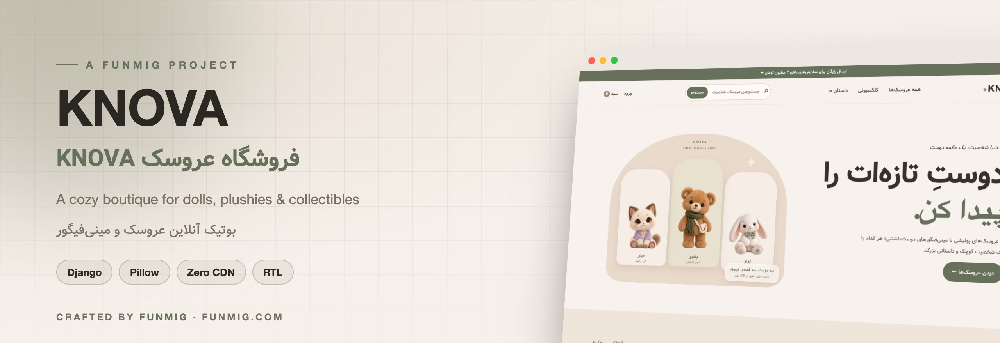
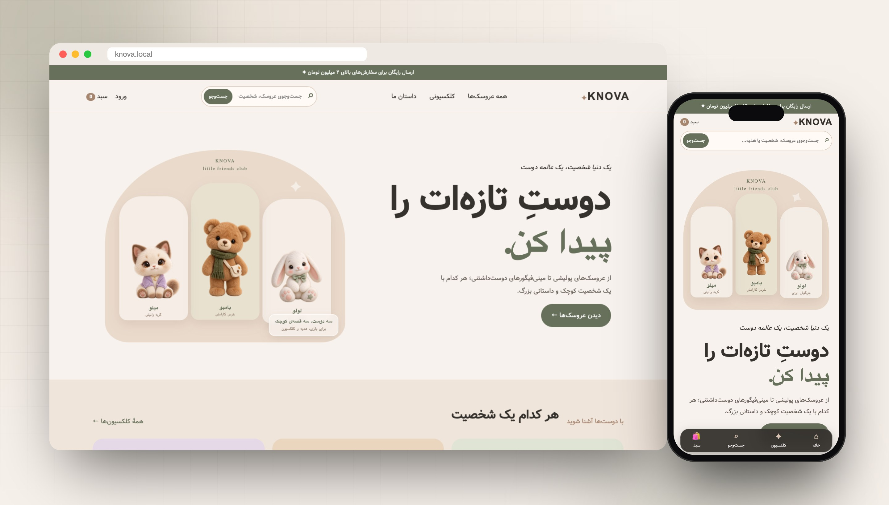
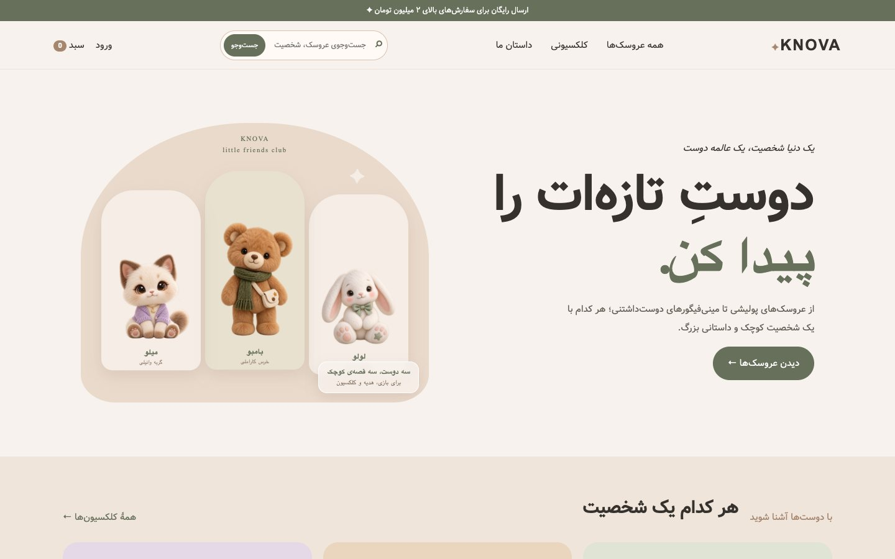
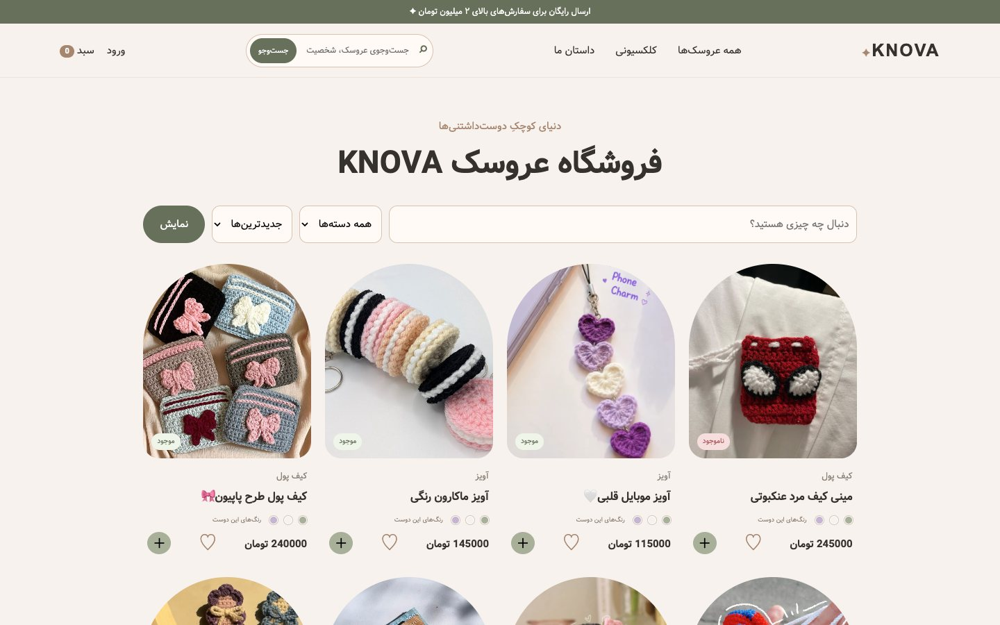
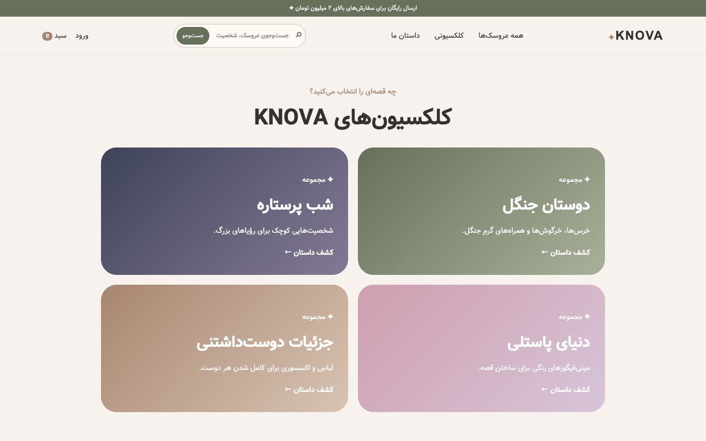
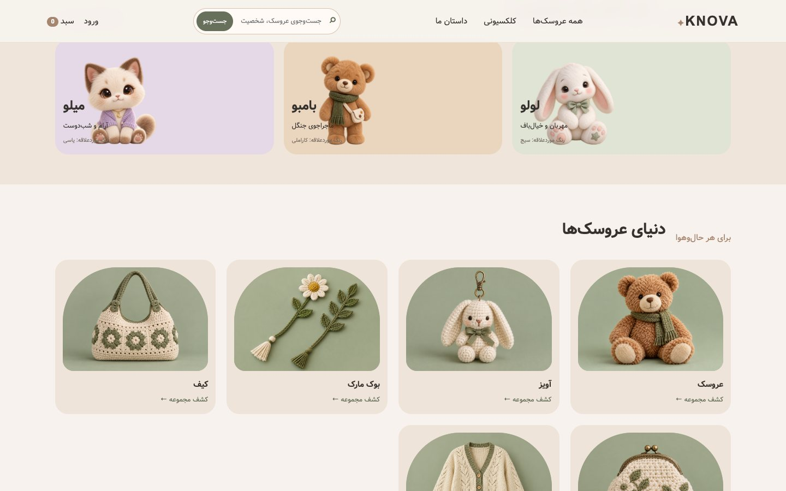
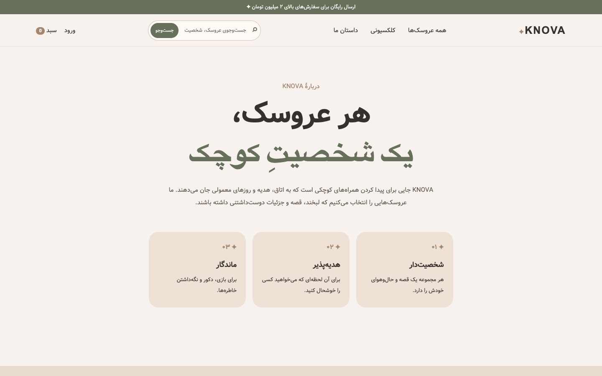
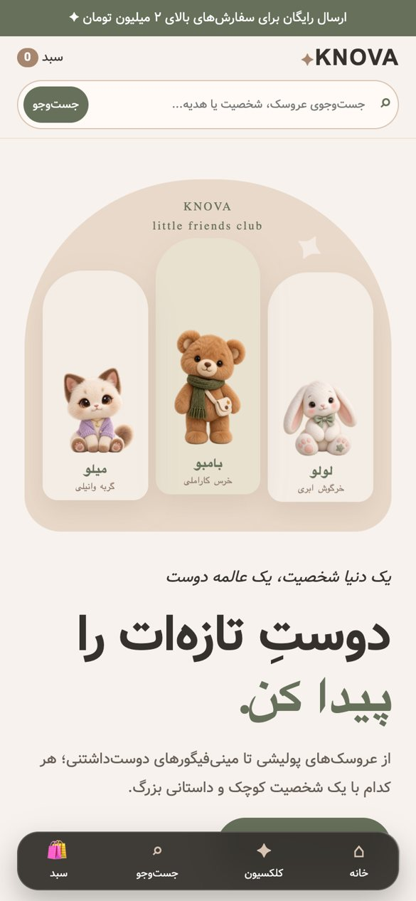

<div align="center">



<br>


<br><br>

**[🇬🇧 English](#-english)** &nbsp;·&nbsp; **[🇮🇷 فارسی](#-فارسی)**

<br>



</div>

<br>

## 🇬🇧 English

**KNOVA** is a warm, character-driven online boutique for dolls, plushies and mini figures. It's a right-to-left Persian Django store that runs **fully local**: no external fonts, stylesheets, scripts, icons or APIs.

> *"A world of personality, a universe of friends."* Each doll comes with a name, a personality and a small story.

### ✨ Highlights

<table>
<tr>
<td width="50%" valign="top">

#### 🧸 Shopping experience
- Hero with an illustrated **doll family** and character cards
- Categories, themed **collections** and rich product pages
- Image galleries with discount badges and compare-at (sale) prices
- Session cart with quantity updates and **coupon codes**
- Wishlist, user dashboard and saved addresses
- Sticky **mobile bottom navigation** made for thumbs

</td>
<td width="50%" valign="top">

#### 🛠️ Store management
- Branded Django admin theme
- **Staff overview** dashboard for orders & stock
- Store settings: announcement bar, Telegram ID for orders
- `seed_knova` command: categories, products and the `KNOVA10` coupon
- About, contact, FAQ & rules pages
- Hardened production settings (HSTS, secure cookies, proxy SSL)

</td>
</tr>
</table>

### 📸 Screenshots

| Home | Products |
|:---:|:---:|
|  |  |
| **Collections** | **Categories** |
|  |  |

<p align="center">

&nbsp;

</p>

### 🚀 Quick start

```bash
python3 -m venv .venv
source .venv/bin/activate
pip install -r requirements.txt
export DJANGO_DEBUG=True
python manage.py migrate
python manage.py seed_knova
python manage.py createsuperuser
python manage.py runserver
```

The site runs at `http://127.0.0.1:8000`, and the admin is at `/admin/`.

> [!TIP]
> After logging into the admin, open **Store settings** and replace `@YOUR_TELEGRAM_ID` with your real Telegram handle. Customers are sent there to finalize their orders.

### ⚙️ Configuration

| Variable | Default | Description |
|---|---|---|
| `DJANGO_DEBUG` | `False` | Set to `True` for local development |
| `DJANGO_SECRET_KEY` | – | **Required** when `DEBUG` is off |
| `DJANGO_ALLOWED_HOSTS` | `knova.ir,…` | Comma-separated domains |

See [`.env.example`](.env.example). Models and migrations don't depend on SQLite, so switching to PostgreSQL only requires changing `DATABASES`.

### 🌐 Deployment

<details>
<summary><b>Waitress + Nginx + systemd (Debian)</b></summary>

[`deploy/`](deploy) contains a systemd unit, an Nginx site and `install.sh`. The app runs with **Waitress** on `127.0.0.1:8014` behind Nginx. The installer validates the Nginx config and checks that the app responds before it reloads anything.

```bash
sudo bash deploy/install.sh
systemctl status knova
journalctl -u knova -n 50 --no-pager
```

Pinned versions are listed in [`deploy/requirements.lock`](deploy/requirements.lock).
</details>

### 📂 Structure

```
config/       settings, URLs, WSGI
shop/         models, views, forms, cart context, seed_knova command
templates/    shop/, registration/, admin/
static/       css/ (design system, motion, responsive) · js/ · img/ (doll artwork)
deploy/       systemd, nginx, installer, lockfile
```

<br>

---

<div dir="rtl">

## 🇮🇷 فارسی

**KNOVA** یک بوتیک آنلاین گرم و شخصیت‌محور برای عروسک‌های پولیشی و مینی‌فیگورهاست. فروشگاه با Django، به زبان فارسی و راست‌چین ساخته شده و **کاملاً محلی** است. یعنی هیچ فونت، استایل، اسکریپت، آیکون یا API خارجی‌ای ندارد.

> *«یک دنیا شخصیت، یک عالمه دوست»*: هر عروسک یک اسم، یک شخصیت و یک داستان کوچک دارد.

### ✨ امکانات

- صفحه اول با تصویرسازی **خانواده عروسک‌ها** و کارت‌های شخصیت
- دسته‌بندی‌ها، **کلکسیون‌های موضوعی** و صفحه کامل محصول
- گالری تصویر، نشان تخفیف و قیمت قبل از تخفیف
- سبد خرید با تغییر تعداد و **کد تخفیف**
- علاقه‌مندی‌ها، داشبورد کاربر و آدرس‌های ذخیره‌شده
- **منوی پایین موبایل** برای استفاده راحت با یک دست
- قالب اختصاصی ادمین و داشبورد **نمای کلی کارکنان**
- تنظیمات فروشگاه: نوار اطلاعیه و آیدی تلگرام برای نهایی‌کردن سفارش
- فرمان `seed_knova` برای ساخت دسته‌ها، محصولات و کوپن `KNOVA10`

### 🚀 اجرا

```bash
python3 -m venv .venv
source .venv/bin/activate
pip install -r requirements.txt
export DJANGO_DEBUG=True
python manage.py migrate
python manage.py seed_knova
python manage.py createsuperuser
python manage.py runserver
```

سایت در `http://127.0.0.1:8000` و پنل مدیریت در `/admin/` در دسترس است.

> [!TIP]
> بعد از ورود به ادمین، در بخش «تنظیمات فروشگاه» شناسه `@YOUR_TELEGRAM_ID` را با آیدی واقعی تلگرام خودتان عوض کنید.

### 🌐 استقرار

فایل‌های آماده systemd، Nginx و اسکریپت نصب در پوشه [`deploy/`](deploy) قرار دارند. برنامه با Waitress روی `127.0.0.1:8014` و پشت Nginx اجرا می‌شود. پیش از انتشار حتماً `DJANGO_SECRET_KEY` را تنظیم کنید و `DJANGO_DEBUG` را خاموش نگه دارید.

</div>

<br>

---

<div align="center">

**Crafted with ❤️ by [FUNMIG](https://funmig.com)**

<sub>طراحی و توسعه توسط تیم فان‌میگ</sub>

</div>
